<p align="center">
  
</p>

<h1 align="center">Aplikasi Web Chibisafe</h1>
<p align="center">
  <b>Tugas Praktikum Deployment Server — Mata Kuliah Komunikasi Data dan Jaringan Komputer (KDJK)</b>
</p>

<p align="center">
  
  
  
  
  
</p>

---

## 👥 Anggota Kelompok

Proyek ini disusun untuk memenuhi tugas mata kuliah **Komunikasi Data dan Jaringan Komputer (KDJK)**:

| NIM | Nama Mahasiswa |
|---|---|
| `M0403241020` | **Faizah Nayda Shalihah** |
| `M0403241118` | **Diara Thufalleasyah Putra** |
| `M0403241027` | **Avirell Shianne Chrisly** |
| `M0403241051` | **Fairuz Hibatullah** |

---

## 📑 Daftar Isi

- [Sekilas Tentang](#sekilas-tentang)
  - [Teknologi yang Digunakan](#teknologi-yang-digunakan)
- [Spesifikasi Kebutuhan VPS](#spesifikasi-kebutuhan-vps)
- [Instalasi](#instalasi)
  - [1. Prasyarat](#1-prasyarat)
  - [2. Menghubungkan ke Server VPS (SSH)](#2-menghubungkan-ke-server-vps-ssh)
  - [3. Instalasi Docker](#3-instalasi-docker)
  - [4. Memeriksa Docker](#4-memeriksa-docker)
  - [5. Membuat Direktori Instalasi](#5-membuat-direktori-instalasi)
  - [6. Membuat File Docker Compose](#6-membuat-file-docker-compose)
  - [7. Membuat File Caddyfile](#7-membuat-file-caddyfile)
  - [8. Menjalankan Chibisafe](#8-menjalankan-chibisafe)
  - [9. Mengakses Aplikasi](#9-mengakses-aplikasi)
  - [10. Login Pertama Kali](#10-login-pertama-kali)
- [Konfigurasi](#konfigurasi)
  - [1. Batas Upload File](#1-batas-upload-file)
  - [2. Penyimpanan Data](#2-penyimpanan-data)
  - [3. Keamanan Server](#3-keamanan-server)
  - [4. Pengaturan Memori](#4-pengaturan-memori)
  - [5. Plugin dan Integrasi](#5-plugin-dan-integrasi)
- [Maintenance](#maintenance)
  - [1. Memeriksa Status Aplikasi](#1-memeriksa-status-aplikasi)
  - [2. Melihat Log Aplikasi](#2-melihat-log-aplikasi)
  - [3. Memperbarui Aplikasi](#3-memperbarui-aplikasi)
  - [4. Backup Data](#4-backup-data)
  - [5. Restore Data (Pemulihan Data)](#5-restore-data-pemulihan-data)
  - [6. Menghentikan Aplikasi](#6-menghentikan-aplikasi)
- [Otomatisasi](#otomatisasi)
- [Cara Pemakaian](#cara-pemakaian)
- [Pembahasan](#pembahasan)
- [Referensi](#referensi)

---

## Sekilas Tentang

**Chibisafe** adalah aplikasi web open-source untuk mengunggah, menyimpan, mengelola, dan membagikan file melalui tautan. Aplikasi ini dapat digunakan sebagai layanan penyimpanan file pribadi yang di-host pada server sendiri (*self-hosted*).

Chibisafe mendukung berbagai jenis file, seperti gambar, video, dokumen, dan berkas lainnya. Pengguna juga dapat mengelompokkan file ke dalam album, membuat tautan berbagi, serta mengelola file melalui dashboard web.

Pada proyek ini, Chibisafe dijalankan pada VPS dengan sistem operasi Ubuntu 24.04 LTS menggunakan Docker Compose.

### Teknologi yang Digunakan

- **Ubuntu 24.04 LTS**: Sistem operasi server VPS.
- **Docker Engine & Docker Compose**: Platform containerization untuk isolasi layanan dan kemudahan replikasi environment.
- **Chibisafe**: Aplikasi utama (frontend berbasis Next.js dan backend berbasis Fastify).
- **Caddy**: Web server dan reverse proxy modern dengan performa tinggi.
- **SQLite**: Database tersemat (*embedded*) ringan yang disimpan pada volume lokal VPS.

---

## 🖥️ Spesifikasi Kebutuhan VPS

Berikut adalah rincian kebutuhan spesifikasi server Virtual Private Server (VPS) untuk menjalankan Chibisafe:

| Komponen | Kebutuhan Minimum | Rekomendasi | Spesifikasi yang Digunakan | Keterangan |
|---|---|---|---|---|
| **CPU (Processor)** | 1 vCPU | 1 - 2 vCPU | **1 vCPU** | Cukup untuk memproses request upload, kompresi, dan hashing file. |
| **RAM (Memori)** | 1 GB (+ swap) | 2 GB atau lebih | **2 GB RAM** | Container Chibisafe + Caddy membutuhkan ~250–500 MB RAM, sisa dialokasikan untuk OS dan caching I/O. |
| **Storage (Penyimpanan)** | 10 GB SSD | 25 GB+ SSD / NVMe | **25 GB NVMe** | Menggunakan NVMe SSD untuk kecepatan *chunked upload* berkecepatan tinggi. Sisa kapasitas digunakan untuk media uploads. |
| **Sistem Operasi** | Ubuntu 20.04+ | Ubuntu 22.04 / 24.04 LTS | **Ubuntu 24.04 LTS (64-bit)** | Kompatibilitas kernel modern untuk Docker Engine. |
| **Jaringan / Port** | 100 Mbps, IP Publik | 1 Gbps, IP Publik | **1 Gbps Shared, 1x IPv4** | Port terbuka: `22` (SSH), `24424` (Aplikasi Chibisafe). |

> [!NOTE]
> **Analisis Sumber Daya:** Spesifikasi **1 vCPU, 2 GB RAM, dan 25 GB NVMe** terbukti sangat optimal dan efisien untuk Chibisafe karena aplikasi ini menggunakan SQLite tanpa beban overhead proses database server terpisah (seperti MySQL atau PostgreSQL), serta Caddy yang sangat hemat memori (~20-50 MB).

---

## Instalasi

### 1. Prasyarat

Sebelum melakukan instalasi, pastikan data berikut telah tersedia dari penyedia VPS:

- Alamat IP Publik VPS (contoh: `103.xxx.xxx.xxx`).
- Username SSH (`root` atau pengguna dengan hak akses `sudo`).
- Port SSH (standar: `22`, atau port khusus dari penyedia VPS).
- Password SSH atau berkas SSH Private Key (`.pem` / `.id_rsa`).
- Port TCP `24424` dapat diakses, atau tersedia SSH tunnel untuk pengujian lokal.

---

### 2. Menghubungkan ke Server VPS (SSH)

Buka aplikasi terminal pada komputer lokal Anda (PowerShell, Command Prompt, Git Bash pada Windows, atau Terminal pada Linux/macOS).

<details open>
<summary><b>Klik untuk melihat perintah koneksi SSH</b></summary>

**a. Menghubungkan dengan port standar (22):**

```bash
ssh root@IP-VPS
```

> Ganti `root` dengan username Anda (jika bukan root) dan `IP-VPS` dengan alamat IP server Anda.

**b. Menghubungkan dengan port SSH khusus:**

Jika penyedia VPS Anda menggunakan port non-standar (misal port `20217`):

```bash
ssh -p 20217 root@IP-VPS
```

**c. Menghubungkan menggunakan berkas SSH Key:**

Jika VPS menggunakan autentikasi key:

```bash
ssh -i /path/ke/private-key root@IP-VPS
```

</details>

**Proses saat pertama kali terhubung:**

1. Sistem akan menampilkan peringatan verifikasi *host fingerprint*. Ketik `yes` lalu tekan **Enter**:
   ```text
   The authenticity of host '103.xxx.xxx.xxx' can't be established.
   ED25519 key fingerprint is SHA256:xxxxxxxxxxxxxxxxxxxxxxxxxxxxxxxxxxxxxxxxxxx.
   Are you sure you want to continue connecting (yes/no/[fingerprint])? yes
   ```
2. Masukkan password akun VPS Anda saat diminta (teks password tidak akan tampil di layar saat diketik demi keamanan).
3. Setelah login berhasil, prompt terminal server akan aktif:
   ```bash
   root@vps-ubuntu:~#
   ```

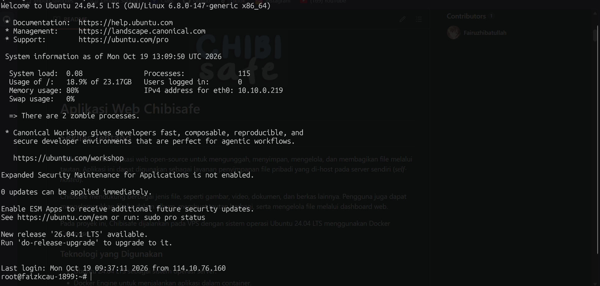  
*Gambar 1. Tampilan saat berhasil terhubung ke server VPS melalui SSH.*

---

### 3. Instalasi Docker

Setelah terhubung ke terminal VPS, perbarui paket sistem dan pasang dependensi yang diperlukan:

```bash
sudo apt update
sudo apt install -y ca-certificates curl gnupg
```

Tambahkan repository resmi Docker:

```bash
sudo install -m 0755 -d /etc/apt/keyrings
curl -fsSL https://download.docker.com/linux/ubuntu/gpg | sudo gpg --dearmor -o /etc/apt/keyrings/docker.gpg
sudo chmod a+r /etc/apt/keyrings/docker.gpg

echo \
  "deb [arch=$(dpkg --print-architecture) signed-by=/etc/apt/keyrings/docker.gpg] https://download.docker.com/linux/ubuntu \
  $(. /etc/os-release && echo "$VERSION_CODENAME") stable" | \
  sudo tee /etc/apt/sources.list.d/docker.list > /dev/null
```

Pasang Docker Engine dan plugin Compose:

```bash
sudo apt update
sudo apt install -y docker-ce docker-ce-cli containerd.io docker-buildx-plugin docker-compose-plugin
```

> [!TIP]
> Referensi dokumentasi resmi: [Install Docker Engine on Ubuntu](https://docs.docker.com/engine/install/ubuntu/)

---

### 4. Memeriksa Docker

Periksa versi Docker dan plugin Compose:

```bash
docker --version
docker compose version
```

Pastikan Docker service berjalan aktif:

```bash
systemctl status docker
```

Jika status belum `active (running)`, jalankan:

```bash
sudo systemctl start docker
sudo systemctl enable docker
```

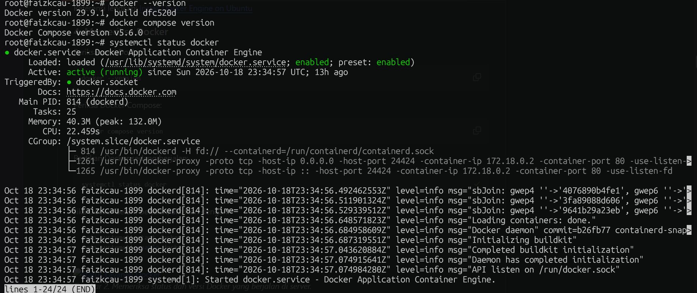  
*Gambar 2. Memeriksa status dan versi Docker yang berjalan di server.*

---

### 5. Membuat Direktori Instalasi

Buat direktori khusus proyek untuk mengisolasi konfigurasi Chibisafe:

```bash
mkdir -p /opt/chibisafe
cd /opt/chibisafe
```

Struktur direktori awal yang dibutuhkan:

```
└── chibisafe
    ├── docker-compose.yml
    └── Caddyfile
```

> [!NOTE]
> Direktori `database/`, `uploads/`, dan `logs/` akan secara otomatis dibuat oleh Docker saat container pertama kali dijalankan.

---

### 6. Membuat File Docker Compose

Buat file konfigurasi:

```bash
nano docker-compose.yml
```

Isi dengan konfigurasi berikut:

```yaml
services:
  chibisafe:
    image: chibisafe/chibisafe:latest
    environment:
      - BASE_API_URL=http://chibisafe_server:8000
    expose:
      - "8001"
    restart: unless-stopped

  chibisafe_server:
    image: chibisafe/chibisafe-server:latest
    volumes:
      - ./database:/app/database:rw
      - ./uploads:/app/uploads:rw
      - ./logs:/app/logs:rw
    expose:
      - "8000"
    restart: unless-stopped

  caddy:
    image: caddy:2-alpine
    volumes:
      - ./Caddyfile:/etc/caddy/Caddyfile:ro
      - ./uploads:/app/uploads:ro
    ports:
      - "24424:80"
    environment:
      - BASE_URL=":80"
    restart: unless-stopped
```

Simpan file dengan menekan `Ctrl + O`, lalu `Enter`, dan keluar menggunakan `Ctrl + X`.

**Penjelasan Peran Layanan:**

| Layanan | Image | Fungsi Utama |
|---|---|---|
| `chibisafe` | `chibisafe/chibisafe:latest` | Frontend Chibisafe (Next.js) yang melayani antarmuka web di port internal `8001` |
| `chibisafe_server` | `chibisafe/chibisafe-server:latest` | Backend API Chibisafe (Fastify) di port internal `8000` |
| `caddy` | `caddy:2-alpine` | Reverse proxy internal yang menyatukan frontend & backend ke port tunggal `24424` |

> [!IMPORTANT]
> Jangan menghapus layanan `caddy` dari `docker-compose.yml` meskipun host sudah menggunakan reverse proxy lain (seperti NGINX Proxy Manager atau Cloudflare), karena Chibisafe memerlukan Caddy bawaan untuk perutean file upload dan API internal.

---

### 7. Membuat File Caddyfile

Buat file konfigurasi perutean Caddy:

```bash
nano Caddyfile
```

Masukkan konfigurasi berikut:

```caddyfile
{
    servers {
        trusted_proxies static private_ranges
        client_ip_headers X-Forwarded-For X-Real-IP
    }
}

{$BASE_URL} {
    route {
        file_server * {
            root /app/uploads
            pass_thru
        }

        @api path /api/*
        reverse_proxy @api http://chibisafe_server:8000 {
            header_up Host {http.reverse_proxy.upstream.hostport}
            header_up X-Real-IP {http.request.header.X-Real-IP}
        }

        @docs path /docs*
        reverse_proxy @docs http://chibisafe_server:8000 {
            header_up Host {http.reverse_proxy.upstream.hostport}
            header_up X-Real-IP {http.request.header.X-Real-IP}
        }

        reverse_proxy http://chibisafe:8001 {
            header_up Host {http.reverse_proxy.upstream.hostport}
            header_up X-Real-IP {http.request.header.X-Real-IP}
        }
    }
}
```

Simpan file (`Ctrl + O`, `Enter`, `Ctrl + X`).

**Penjelasan Alur Routing Caddy:**

| Pola URL | Tujuan Penanganan |
|---|---|
| File statis di `/app/uploads` | Disajikan langsung oleh Caddy (`file_server`) tanpa membebani backend |
| `/api/*` | Diteruskan ke backend Chibisafe (port `8000`) |
| `/docs*` | Diteruskan ke dokumentasi API backend (port `8000`) |
| Semua path lainnya | Diteruskan ke frontend Chibisafe (port `8001`) |

---

### 8. Menjalankan Chibisafe

Pastikan berada di direktori `/opt/chibisafe`, lalu jalankan container secara background:

```bash
docker compose up -d
```

Periksa status container:

```bash
docker compose ps
```

Pastikan ketiga container (`chibisafe`, `chibisafe_server`, `caddy`) berstatus **`Up`**. Jika terjadi kendala, amati log aplikasi:

```bash
docker compose logs --tail=100
```

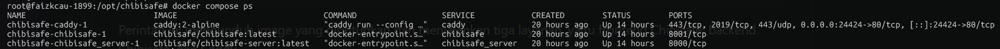  
*Gambar 3. Status ketiga container Chibisafe yang berhasil dijalankan.*

---

### 9. Mengakses Aplikasi

Buka browser di komputer lokal Anda, lalu akses alamat:

```text
http://IP-VPS:24424
```

> [!TIP]
> **Menggunakan SSH Tunnel (Bila Port 24424 Dibatasi Firewall):**  
> Jalankan perintah berikut pada terminal komputer lokal:
> ```bash
> ssh -L 12424:127.0.0.1:24424 root@IP-VPS
> ```
> *(Jika port SSH non-standar, tambahkan parameter `-p PORT`, contoh: `-p 20217`)*.  
> Setelah terhubung, buka browser pada alamat: `http://localhost:12424`.

---

### 10. Login Pertama Kali

Kredensial bawaan (*default*) instalasi baru Chibisafe:

- **Username:** `admin`
- **Password:** `admin`

> [!WARNING]
> **Segera ganti kata sandi bawaan setelah berhasil login!** Menggunakan kredensial default pada server yang terhubung ke internet sangat berisiko.

**Langkah Mengubah Kata Sandi:**
1. Masuk menggunakan kredensial default.
2. Klik avatar profil di sudut kanan atas dashboard.
3. Pilih menu akun / profil.
4. Perbarui password dengan kombinasi kata sandi baru yang kuat.

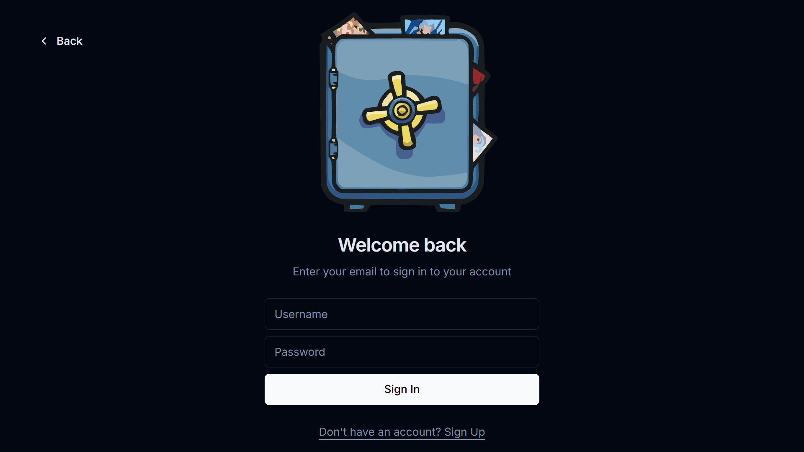  
*Gambar 4. Tampilan halaman login Chibisafe.*

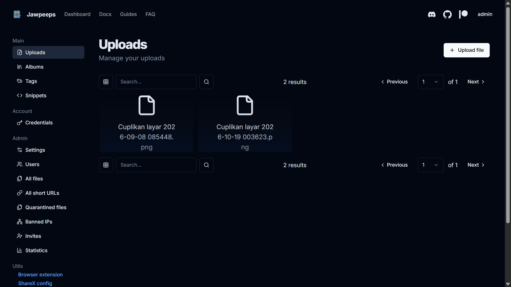  
*Gambar 5. Tampilan dashboard utama setelah berhasil masuk.*

---

## Konfigurasi

### 1. Batas Upload File

Administrator dapat mengonfigurasi batas ukuran berkas, ekstensi yang diizinkan, dan parameter layanan lainnya langsung dari dashboard web Chibisafe pada menu **Settings**:

- **Service name**: Nama layanan yang ditampilkan pada antarmuka publik.
- **Maximum file size**: Batas ukuran file maksimum per berkas (misal: 100 MB, 500 MB, 2 GB).
- **Chunk size**: Ukuran potongan transmisi file (*chunking*) saat mengunggah file besar.
- **Allowed file extensions**: Pembatasan ekstensi berkas yang boleh disimpan.
- **User registration**: Opsi untuk membuka atau menutup pendaftaran akun publik.

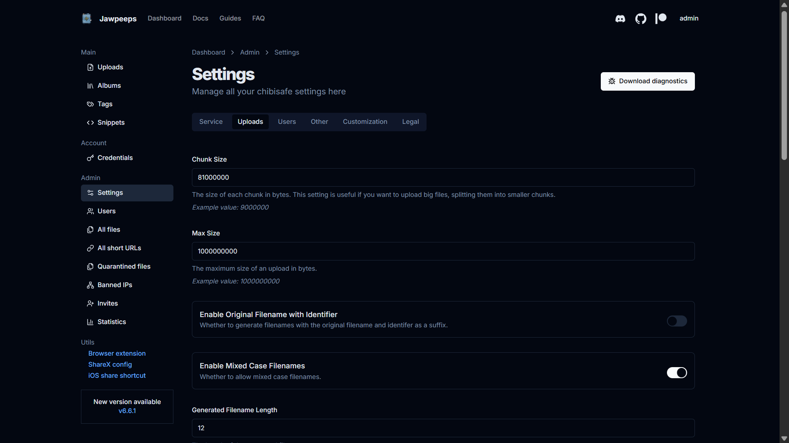  
*Gambar 6. Tampilan halaman pengaturan (Settings) pada dashboard administrator.*

### 2. Penyimpanan Data

Data persisten disimpan pada volume lokal server VPS:

| Direktori Host | Fungsi & Tipe Data |
|---|---|
| `/opt/chibisafe/database/` | File database SQLite (`chibisafe.db`), tabel relasi pengguna, file, dan album |
| `/opt/chibisafe/uploads/` | Berkas asli yang diunggah oleh pengguna |
| `/opt/chibisafe/logs/` | Catatan aktivitas (*system logs*) aplikasi |

### 3. Keamanan Server

- Ganti kata sandi `admin` segera setelah instalasi.
- Gunakan sertifikat SSL/HTTPS bila dipasang pada nama domain publik.
- Jangan membuka port internal `8000` dan `8001` ke internet publik (gunakan expose, bukan ports).
- Terapkan firewall (UFW) pada VPS: `sudo ufw allow 22` dan `sudo ufw allow 24424`.
- Lakukan pencadangan (*backup*) secara berkala.

### 4. Pengaturan Memori

Pantau pemakaian memori VPS secara langsung dengan:

```bash
free -h
docker stats
```

### 5. Plugin dan Integrasi

Chibisafe mendukung integrasi dengan uploader eksternal:
- **ShareX**: Unggah otomatis hasil tangkapan layar langsung ke server.
- **Ekstensi Browser**: Unggah gambar web langsung melalui klik kanan.
- **API Token**: Akses REST API untuk otomatisasi skrip eksternal (diperoleh dari menu **Uploaders**).

---

## Maintenance

### 1. Memeriksa Status Aplikasi

```bash
cd /opt/chibisafe
docker compose ps
```

### 2. Melihat Log Aplikasi

```bash
# Melihat 100 baris log terakhir
docker compose logs --tail=100

# Memantau log secara real-time
docker compose logs -f
```

*(Tekan `Ctrl + C` untuk keluar dari pemantauan log).*

### 3. Memperbarui Aplikasi

```bash
cd /opt/chibisafe
docker compose pull
docker compose up -d
```

### 4. Backup Data

Cadangkan seluruh database dan file yang diunggah ke dalam berkas arsip `.tar.gz`:

```bash
cd /opt/chibisafe
tar -czf "/root/chibisafe-backup-$(date +%F).tar.gz" database uploads
```

> [!TIP]
> Untuk keamanan data yang lebih terjamin, salin file arsip backup dari VPS ke komputer lokal menggunakan perintah `scp`:
> ```bash
> scp root@IP-VPS:/root/chibisafe-backup-*.tar.gz C:\Backup-Lokal\
> ```

---

### 5. Restore Data (Pemulihan Data)

Jika terjadi kerusakan sistem atau Anda ingin memindahkan data ke VPS baru, ikuti prosedur restore berikut:

**Langkah 1: Hentikan container Chibisafe**
```bash
cd /opt/chibisafe
docker compose down
```

**Langkah 2: Amankan folder data lama (opsional namun disarankan)**
```bash
cd /opt/chibisafe
mv database database_old 2>/dev/null || true
mv uploads uploads_old 2>/dev/null || true
```

**Langkah 3: Ekstrak file arsip backup**
```bash
# Ganti YYYY-MM-DD dengan tanggal berkas backup Anda
tar -xzf /root/chibisafe-backup-YYYY-MM-DD.tar.gz -C /opt/chibisafe
```

**Langkah 4: Atur hak akses direktori**
Pastikan direktori yang diekstrak memiliki izin baca/tulis yang dapat diakses oleh container:
```bash
chmod -R 755 /opt/chibisafe/database /opt/chibisafe/uploads
```

**Langkah 5: Jalankan kembali container**
```bash
cd /opt/chibisafe
docker compose up -d
```

**Langkah 6: Verifikasi pemulihan**
Periksa status dan log container untuk memastikan database terbaca dengan baik:
```bash
docker compose ps
docker compose logs chibisafe_server --tail=50
```
Buka antarmuka web di browser dan pastikan akun, album, serta file lama telah kembali. Setelah dipastikan normal, folder `database_old` dan `uploads_old` dapat dihapus (`rm -rf database_old uploads_old`).

---

### 6. Menghentikan Aplikasi

```bash
cd /opt/chibisafe
docker compose down
```

> [!CAUTION]
> Jangan menambahkan argumen `-v` (`docker compose down -v`) karena dapat menghapus konfigurasi volume yang terkait dengan container.

---

## Otomatisasi

Untuk mengotomatiskan pencadangan harian tanpa intervensi manual, gunakan penjadwal cron di VPS.

Buka editor crontab:

```bash
crontab -e
```

Tambahkan jadwal backup setiap hari pukul 02.00 pagi:

```cron
0 2 * * * cd /opt/chibisafe && tar -czf "/root/chibisafe-backup-$(date +\%F).tar.gz" database uploads
```

---

## Cara Pemakaian

### 1. Login

Buka browser dan akses alamat aplikasi (`http://IP-VPS:24424` atau `http://localhost:12424`). Masukkan username dan password akun Anda.

### 2. Mengunggah File

1. Klik tombol **Upload** atau seret (*drag and drop*) file langsung ke antarmuka utama.
2. File berukuran besar akan otomatis diunggah secara bertahap menggunakan mekanisme *chunking*.
3. Setelah selesai, berkas akan tercantum pada tabel manajemen file.

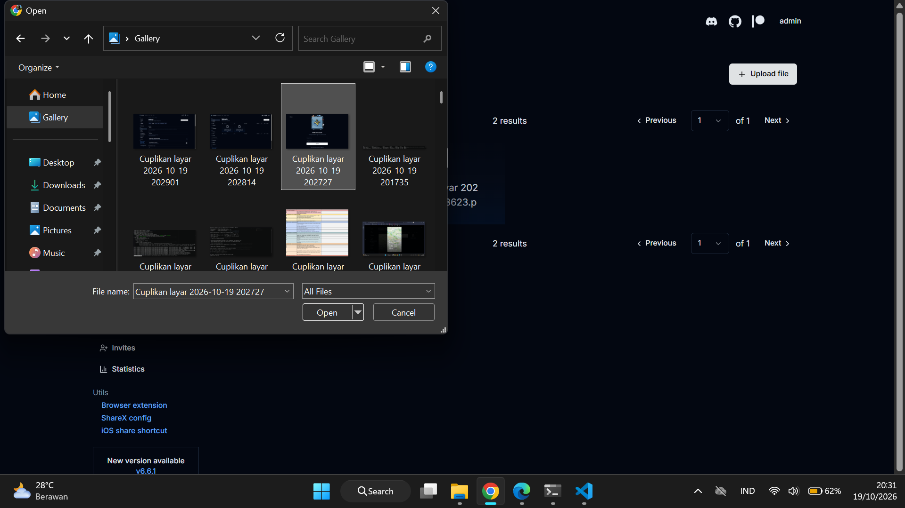  
*Gambar 7. Proses upload file ke antarmuka web Chibisafe.*

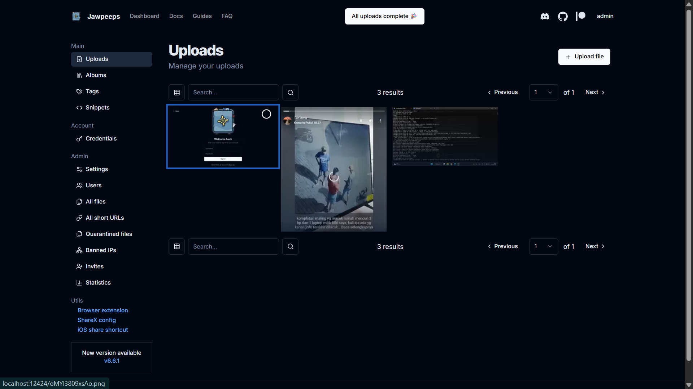  
*Gambar 8. Tampilan file yang berhasil diunggah dan muncul di daftar file.*

### 3. Membagikan File

1. Klik file yang telah diunggah pada dashboard.
2. Salin tautan publik (*share link*) yang disediakan.
3. Tautan dapat dibagikan kepada siapa saja untuk langsung melihat atau mengunduh file tanpa perlu login.

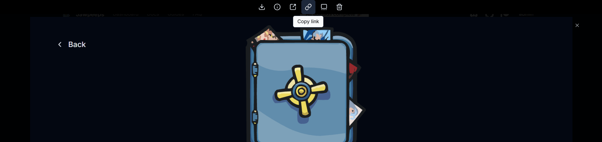  
*Gambar 9. Mengambil tautan (link) publik untuk membagikan file.*

### 4. Mengelola Album dan File

1. Buka menu **Albums** pada sidebar untuk membuat album baru.
2. Kelompokkan berkas sesuai topik atau kategori.
3. Gunakan filter pencarian untuk menemukan file secara instan berdasarkan nama, tag, atau tanggal unggah.

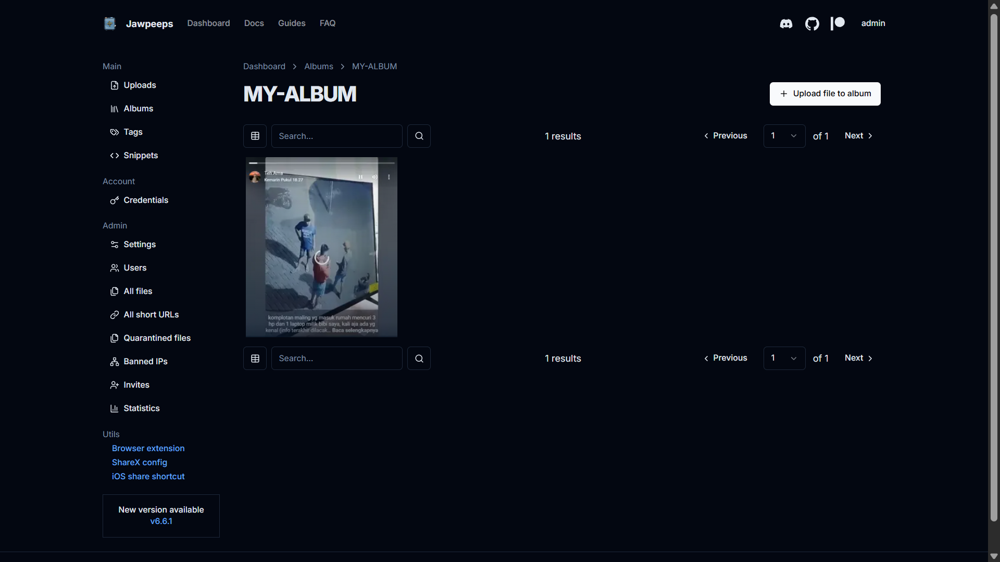  
*Gambar 10. Tampilan halaman pengelolaan album file.*

### 5. Mengelola Pengguna (Administrator)

1. Buka menu **Users** pada bilah sisi navigasi.
2. Pantau seluruh pengguna terdaftar beserta kuota dan jumlah berkas yang mereka miliki.
3. Administrator dapat menonaktifkan akun atau menghapus berkas yang melanggar aturan penyimpanan.

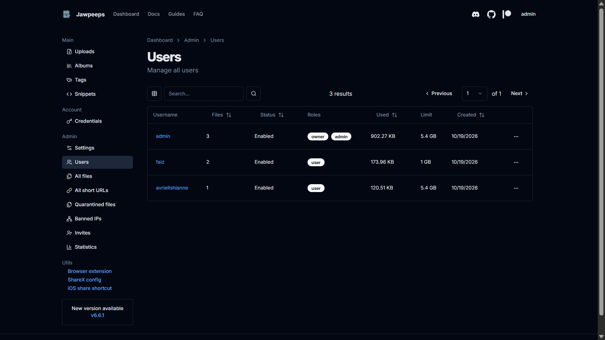  
*Gambar 11. Halaman manajemen pengguna oleh administrator.*

---

## Pembahasan

### Kelebihan

- **Kontrol Penuh Data**: Seluruh data dan privasi tetap berada di tangan pengelola server tanpa bergantung pada pihak ketiga.
- **Efisiensi Sumber Daya**: Berjalan lancar pada spesifikasi VPS 1 vCPU dan 2 GB RAM dengan konsumsi sumber daya yang sangat stabil.
- **Fitur Modern**: Mendukung *chunked upload*, pembuat album, tag pencarian, dan tautan publik langsung.
- **Ekosistem Docker**: Proses instalasi, backup, restore, dan migrasi server sangat ringkas dan terstandarisasi.
- **Integrasi Mudah**: Terintegrasi baik dengan utilitas tangkapan layar seperti ShareX dan ekstensi peramban.

### Kekurangan dan Tantangan

- **Tanggung Jawab Pemeliharaan**: Pembaruan sistem operasi, keamanan jaringan firewall, serta backup rutin harus dikelola sendiri secara mandiri.
- **Kapasitas Terbatas**: Batas kuota penyimpanan ditentukan sepenuhnya oleh kapasitas disk VPS (25 GB NVMe).
- **Ketiadaan Kolaborasi Dokumen**: Bukan merupakan office suite (seperti Google Docs atau Nextcloud Files); tidak mendukung penyuntingan dokumen kolaboratif secara real-time.

### Perbandingan dengan Solusi Sejenis

Untuk memahami posisi dan karakteristik teknis Chibisafe dalam konteks **Komunikasi Data dan Jaringan Komputer (KDJK)**, berikut adalah perbandingan komprehensif antara **Chibisafe**, **Nextcloud**, dan **File Browser**:

| Kategori / Fitur | Chibisafe | Nextcloud | File Browser |
|---|---|---|---|
| **Fokus & Use Case Utama** | Penyimpanan & berbagi file/media cepat via URL publik instan | Platform kolaborasi kerja & cloud storage lengkap (Enterprise) | Web file manager ringan untuk menjelajah direktori lokal server |
| **Kebutuhan RAM (Memory Footprint)** | **Sangat Ringan** (~250 – 400 MB) | **Berat** (Minimum 1 GB, Rekomendasi 2 – 4 GB+) | **Ultra Ringan** (~30 – 80 MB) |
| **Kebutuhan CPU** | **Rendah** (1 vCPU sangat optimal) | **Sedang – Tinggi** (Minimal 2 vCPU untuk performa stabil) | **Sangat Rendah** (1 vCPU sangat cukup) |
| **Arsitektur Database** | **SQLite (Embedded)**, tersimpan langsung dalam volume host tanpa server DB terpisah | **RDBMS Eksternal** (MariaDB / PostgreSQL / MySQL) + Redis in-memory cache | **Embedded DB** (bawaan single binary Go / SQLite) |
| **Mekanisme Upload File Besar** | Mendukung **Chunked Upload otomatis** bawaan via antarmuka web | Mendukung **Chunking Protocol** Nextcloud & sync client desktop | Terbatas pada batas *body size* HTTP reverse proxy |
| **Mekanisme Berbagi Tautan (Link)** | **Direct link publik instan** (cocok untuk disematkan/embed di web/forum) | Tautan berbagi publik dengan proteksi password, limit unduhan, & expiry date | Tautan berbagi sementara (*quick share link*) sederhana |
| **Organisasi & Struktur Berkas** | Sistem **Album virtual**, tagging metadata, & pencarian cepat | **Hierarki folder konvensional**, penandaan warna, versi file (*versioning*), & recycle bin | Struktur folder langsung sesuai hirarki direktori file system OS host |
| **Dukungan Protokol Jaringan** | **HTTP / HTTPS**, RESTful API | **HTTP / HTTPS**, WebDAV, CalDAV (Kalender), CardDAV (Kontak) | **HTTP / HTTPS**, REST API internal |
| **Integrasi Klien Pihak Ketiga** | Dukungan native file konfigurasi **ShareX**, browser extension, CLI | Aplikasi resmi Desktop (Windows/macOS/Linux), Mobile (Android/iOS), & WebDAV | Akses web responsive via peramban (tanpa aplikasi desktop khusus) |
| **Fitur Kolaborasi Dokumen** | ❌ Tidak tersedia (khusus file delivery & hosting) |  Tersedia lengkap (integrasi OnlyOffice / Collabora Online, Chat Talk, Kalender) | ⚠️ Terbatas pada teks editor sederhana (code/markdown editor) |
| **Manajemen Pengguna & Izin (RBAC)** | Role Admin & Regular User, kuota per user | Role-Based Access Control lengkap, grup bertingkat, LDAP / Active Directory | Multi-user dengan izin akses folder berbasis direktori host |
| **Kompleksitas Deployment Docker** | **Sederhana** (3 container: frontend, backend, Caddy reverse proxy) | **Kompleks** (multi-container: app, web server, DB MariaDB, Redis cache, cron worker) | **Sangat Sederhana** (1 container tunggal) |

#### Analisis Kesesuaian Kebutuhan Praktikum

1. **Efisiensi Alokasi Sumber Daya Jaringan & Server**:  
   Pada lingkungan server dengan spesifikasi **1 vCPU, 2 GB RAM, dan 25 GB NVMe**, **Chibisafe** memberikan titik keseimbangan (*sweet spot*) yang ideal. Nextcloud memerlukan sumber daya komputasi yang jauh lebih besar karena menjalankan stack PHP, service database mandiri, dan daemon Redis. Sebaliknya, File Browser sangat hemat sumber daya namun fiturnya murni sebatas file manager tanpa kapabilitas manajemen album atau tautan berbagi langsung seperti Chibisafe.

2. **Protokol dan Jalur Komunikasi Data**:  
   Chibisafe mengombinasikan HTTP API backend (Fastify) dan reverse proxy Caddy yang secara langsung menyajikan file statis dari storage host (`file_server`). Arsitektur ini meminimalkan *network hop* internal dan overhead transmisi data, sehingga *throughput* pengunduhan file publik menjadi maksimal.

---

## Referensi

1. Chibisafe. *Official GitHub Repository*. https://github.com/chibisafe/chibisafe
2. Chibisafe Guides. *Running Chibisafe with Docker*. https://github.com/chibisafe/guides/blob/main/docs/installation/running-with-docker.md
3. Chibisafe. *Official Documentation*. https://chibisafe.app/docs/intro
4. Nextcloud. *Nextcloud Server Documentation & Architecture*. https://docs.nextcloud.com/
5. Nextcloud. *Official Docker Image Repository*. https://hub.docker.com/_/nextcloud
6. File Browser. *File Browser Official Documentation*. https://filebrowser.org/
7. File Browser. *Official GitHub Repository*. https://github.com/filebrowser/filebrowser
8. Docker. *Docker Engine & Compose Documentation*. https://docs.docker.com/
9. Docker. *Install Docker Engine on Ubuntu*. https://docs.docker.com/engine/install/ubuntu/
10. Ubuntu. *Ubuntu Server Documentation*. https://documentation.ubuntu.com/server/
11. Caddy. *Caddy Web Server Documentation*. https://caddyserver.com/docs/
12. ShareX. *Custom Uploader Documentation & Guide*. https://getsharex.com/docs/custom-uploader
